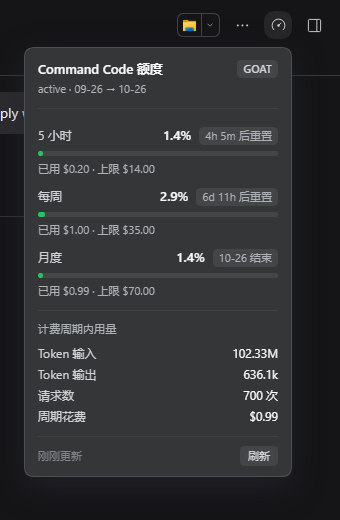

# dsh-commandcode-quota

在 DSH 会话头部查看 Command Code 套餐还剩多少额度。一个图标按钮，点开一张卡片：5 小时 / 每周 / 月度窗口的进度与重置倒计时，外加计费周期内的 token、请求数与花费。



## 安装

```bash
dsh plugin --profile web add github:TianzeLuo/dsh-commandcode-quota
```

1. 重启 `dsh web`
2. 刷新页面

开发调试时可改装本地目录：`dsh plugin --profile web add /path/to/dsh-commandcode-quota`。Windows 上源码与 `$DSH_HOME` 跨盘时不要直接装本地路径，见 [Windows 注意事项](docs/windows.md)。

装不上或装完没反应，看 [已知限制](docs/limitations.md)。

## 兼容性

| 项 | 值 |
| --- | --- |
| DSH | `>=0.2.2-rc.3`（只写下界） |
| 验证于 | 0.2.2-rc.3（2026-11-13，36 项离线测试通过） |
| Node | `>=22.5` |
| 平台 | Windows / WSL2（当前版本在 WSL2 复测；两平台共用同一份代码） |

## 能做什么

- **一眼看到额度**：5 小时、每周、月度三个窗口的已用比例、上限、重置时间与倒计时。
- **看到周期用量**：计费周期内的输入 / 输出 token、请求数与花费。
- **自动发现凭据**：从 DSH profile 的 commandcode provider 路由、`~/.dsh/.credentials.yaml` 与环境变量依次发现，不需要改配置。
- **单个端点失败不影响其余数据**：卡片底部只提示这次没取到的部分。

## 用法

| 触发方式 | 位置 | 行为 |
| --- | --- | --- |
| 点额度图标 | 会话头部右侧工具行 | 展开额度卡片；再点一次、点卡片外或按 Esc 收起 |
| 自动刷新 | 页面加载 / 打开卡片 / 每 10 分钟 | 重新拉取；标签页切回前台且数据过期时补一次 |

关掉插件后：会话头部不再出现额度按钮，已有会话与用量数据不受影响。

配置项、刷新细节与端点契约见 [开发说明](docs/development.md) 与 [数据来源](docs/api.md)；边界见 [已知限制](docs/limitations.md)。

## 已知限制

- 按钮只在会话已开始（发过至少一条消息）后出现。
- token 进出与请求数来自 2–3 分钟一批的聚合，可能略滞后；额度窗口和花费是实时的。
- 账户级 API 不提供缓存命中 / 未命中的拆分，只有毛输入 token 总量。

## 文档

| 文件 | 内容 |
| --- | --- |
| [docs/api.md](docs/api.md) | 四个端点、凭据发现顺序、月度上限与错误码 |
| [docs/development.md](docs/development.md) | 配置、刷新时机、测试与 DSH 契约 |
| [docs/limitations.md](docs/limitations.md) | 已知边界与数据新鲜度 |
| [docs/windows.md](docs/windows.md) | Windows 本地路径安装的跨盘坑与修复 |

## 隐私与数据

- 读取：DSH profile 里的 commandcode provider 路由、`~/.dsh/.credentials.yaml` 与环境变量中的凭据。
- 外发：GET 请求发往 Command Code 的额度接口；查额度不消耗额度。
- 存储：宿主侧只保留约 3 秒的结果缓存，不写凭据或额度历史到磁盘。
- 关闭后：不再轮询；卸载插件不会改动账号或额度。

## 许可证

MIT，见 [LICENSE](LICENSE)。
