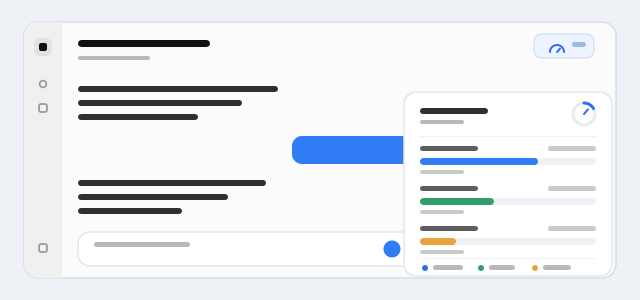

Typical use: after the first message in a session, click the quota button in the header; the card shows each window's used share, its reset time and countdown, plus the billing-period token, request and spend totals. Click again, click outside or press Esc to close it; data refreshes on page load, when the card opens and every ten minutes, and once more when a stale tab returns to the foreground.

Limits: the button appears only after the session has sent at least one message; token and request counts come from batches aggregated every two to three minutes, so they can lag behind the window and spend numbers, which are live; the account API does not split cache hits from cache misses, so input tokens are gross; when one endpoint fails the card keeps the rest of the data and says which part is missing.
