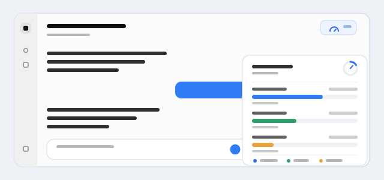

典型用法：会话发出第一条消息后，点会话头部的额度按钮；卡片里每个窗口显示已用比例、重置时间与倒计时，底部是计费周期内的 token、请求数与花费。再点一次、点卡片外或按 Esc 收起；页面加载、打开卡片、每十分钟各刷新一次，标签页切回前台且数据过期时再补一次。

限制：按钮只在会话发过至少一条消息后出现；token 与请求数来自每 2–3 分钟一批的聚合，可能略滞后，额度窗口与花费是实时的；账户 API 不拆分缓存命中与未命中，输入 token 只有毛总量；某个端点失败时卡片保留其余数据并说明缺了哪一块。
